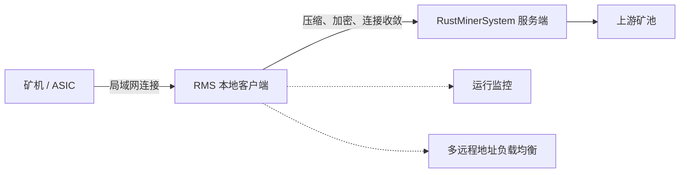
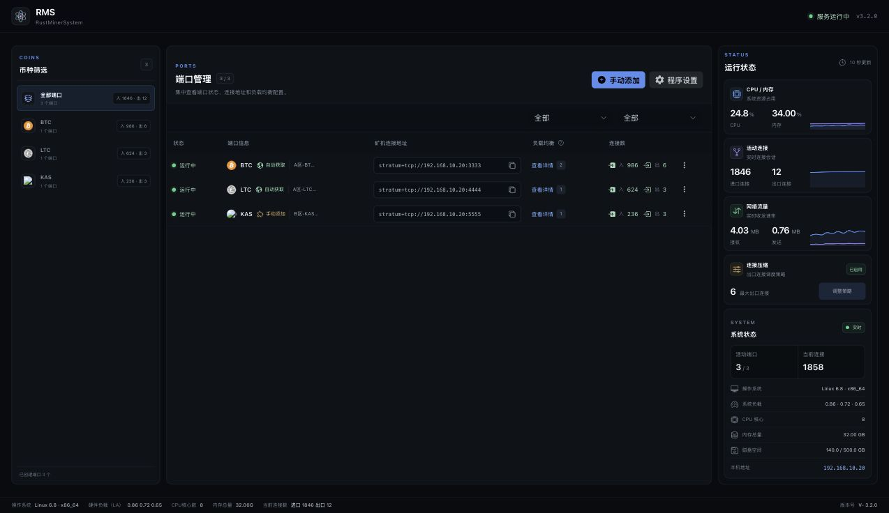

<div align="center">


# RMS

### 面向矿场局域网的 RustMinerSystem 安全接入客户端

压缩公网流量与出口连接数，为本地矿机提供统一、可观测的 RustMinerSystem 接入入口。

[R2 全平台下载](#r2-全平台直接下载) · [官网下载页](https://minerproxy.org/zh/download/rms-secure-client) · [部署文档](https://minerproxy.org/zh/document/rms) · [RustMinerSystem](https://github.com/EvilGenius-dot/RustMinerSystem)

</div>

> [!IMPORTANT]
> RMS 是 RustMinerSystem 的可选本地客户端，不能单独替代 RustMinerSystem 服务端。矿机数量较少、网络稳定且带宽充足时，也可以不部署 RMS，直接连接 RustMinerSystem。

## RMS 如何工作



RMS 通常部署在矿场局域网内。矿机连接本地 RMS 地址，由 RMS 负责与远程 RustMinerSystem 服务端建立压缩传输链路。

## 核心能力

| 能力 | 说明 |
| --- | --- |
| 公网流量压缩 | 使用 RMS3、RMS3(Zstd) 或 RMS3(NB) 降低公网传输体积 |
| 连接数收敛 | 将大量矿机连接复用为更少的公网出口连接 |
| 加密传输 | RMS 与 RustMinerSystem 之间使用受保护的协议链路 |
| 自动配置 | 通过服务端推送地址自动同步端口配置 |
| 手动端口 | 可手动设置本地端口、远程服务器、币种、协议及密码 |
| 负载均衡 | 一个本地端口可以配置多个兼容的远程服务地址 |
| 运行监控 | 查看进出口连接、CPU、内存、网络和端口状态 |
| 后台安全 | 支持访问密码和自定义安全访问路径 |
| 上网行为模拟（仅完整版） | 使用真实浏览器访问公开网页，支持内容浏览、视频观看、共享限速和流量预算，默认关闭 |

## 控制台预览



> 截图使用脱敏的示例矿场数据，界面组件与样式来自 RMS 3.2.0 实际前端工程。

## 版本选择

| 版本 | 上网行为模拟 | 程序体积 | 适合场景 |
| --- | --- | --- | --- |
| **完整版（非 Lite）** | 包含，内置浏览器，默认关闭 | 较大 | 需要上网行为模拟 |
| **Lite 精简版** | 不包含，也不附带浏览器运行包 | 更小 | 只需要矿机接入与传输优化 |

两版均保留矿机接入、协议压缩、加密传输、连接收敛、端口配置和运行监控。主要差异在程序体积；不需要上网行为模拟时可选 Lite。具体大小随平台和发布版本变化。

- Linux：同架构目录下，`rms` 为完整版，`rms-lite` 为 Lite。
- Windows：文件名带 `-lite.exe` 为 Lite，不带 `-lite` 为完整版；两版均提供 GUI 和命令行程序。

新版安装脚本在选择架构后询问版本：`1` 完整版（默认），`2` Lite 精简版。两种版本均安装为 `/root/rms/rms`，共用原有配置与服务，可通过“安装/更新”切换；下载或启动失败时保留或恢复旧程序。Lite 不改写已保存的行为模拟设置，切回完整版后可继续使用。

## 上网行为模拟

仅完整版（非 Lite）包含此功能；Lite 不提供开关或配置入口，卡片会提示下载完整版。旧版需更新至包含此功能的完整版。功能默认关闭，主页右侧“上网行为模拟”卡片的开关立即启停已保存的配置；点击“配置”调整站点和参数，修改通过“保存并应用”生效。

- 内容阅读：通过真实浏览器访问公开网页，随机选择允许范围内的内容链接，停留并滚动阅读。
- 视频观看：可静音尝试播放视频，依据播放进度确认真实播放，再按配置观看和切换；遇到登录、验证码或无法播放时跳过，不自动登录或绕过验证。
- 站点配置：提供百度、贴吧、抖音、哔哩哔哩等预设站点，支持添加带名称的自定义公网 HTTPS 站点，保存后重启仍保留。
- 访问日志：查看最近 200 条页面及资源请求的 URL、状态、耗时、大小和错误原因；日志仅保存在内存中，重启后清空。
- 流量与保护：所有浏览连接共享上下行限速和每日流量预算，达到 CPU 或运行负载保护条件时暂停浏览。

完整版正式发布包内置浏览器，关闭时不释放或启动；首次开启时校验并释放到程序旁的运行库目录，需要程序目录可写，并建议预留至少 3 GiB 额外空间。浏览器仍须满足对应系统、内核和沙箱要求，Linux 以 root 运行或沙箱能力不足时可能无法启动；不能据此认定任意 OpenWrt 或旧系统均可使用。

该功能使用移动浏览器参数，不等同于真实手机的完整指纹。浏览和视频播放仍会占用 CPU、内存、磁盘及带宽，保护机制不能保证完全不影响挖矿；目标站点的访问和播放也可能受网站限制。配置说明见[上网行为模拟文档](https://minerproxy.org/zh/document/rms/mobile-browsing)。

## 协议怎么选

| 协议 | 建议场景 | 注意事项 |
| --- | --- | --- |
| `RMS3(NB)` | BTC、LTC 大规模接入 | 仅支持 BTC 和 LTC；特定测试条件下公网流量最高可减少 99.6% |
| `RMS3(Zstd)` | 希望兼顾压缩效果与 CPU 占用 | 与 RMS3 使用相同的连接逻辑，通常对 CPU 更友好 |
| `RMS3` | 通用高压缩场景 | 压缩级别越高，CPU 压力通常越大 |
| `RMS2` | 对接历史 RMS2 服务端端口 | 用于兼容历史部署，不代表 RMS3 协议向下兼容 |

> [!CAUTION]
> 本地 RMS 的币种、协议、端口密码和压缩设置必须与 RustMinerSystem 服务端端口一致。实际压缩效果与币种、矿机协议、连接数量、压缩参数和硬件性能有关，请以部署实测为准。

## 支持平台

| 平台 | 架构或版本 | 推荐方式 |
| --- | --- | --- |
| Linux | x86-64 | 安装脚本 |
| Linux / OpenWrt | ARMv7 | 安装脚本或手动下载 |
| Linux / OpenWrt | AArch64 | 安装脚本或手动下载 |
| Windows | x64 图形界面 | 下载 GUI 客户端 |
| Windows | x64 命令行 | 下载控制台客户端 |

由于 OpenWrt 发行版和硬件差异较大，建议先确认 CPU 架构，并从少量矿机开始验证。

## Linux 快速安装

安装前请确认：

- 已准备好 RustMinerSystem 服务端 RMS 协议端口。
- RMS 设备具有固定局域网 IP。
- 使用 `root` 用户执行安装。
- 已阅读下面的系统变更说明。

```bash
sudo -i
bash <(curl -s -L https://raw.githubusercontent.com/EvilGenius-dot/RMS/main/install.sh)
```

上面的地址仍用于获取安装脚本。脚本内的「线路1（R2）」从 Cloudflare R2 下载 RMS 程序，原安装命令保持不变；后续版本继续使用固定下载地址。

如果设备无法访问 GitHub，可以使用备用脚本入口：

```bash
sudo -i
bash <(curl -s -L -k http://static.rustminersystem.com/install.sh)
```

> [!NOTE]
> 备用线路当前通过 HTTP 提供。建议仅在可信网络中使用，并在执行前先下载和检查脚本内容。

安装脚本会自动识别常见 CPU 架构，也可以在菜单中手动选择：

- `x86-64`
- `armv7-musleabihf`
- `aarch64`

安装成功后，在同一局域网的浏览器中访问：

```text
http://RMS设备IP:42703
```

### 安装脚本会做什么

当前 Linux 脚本会：

- 将 RMS 安装到 `/root/rms`。
- 更新时先下载、检查 ELF 文件格式/所选架构并备份旧程序，期间现有 RMS 继续运行；完成后才停服务、替换并启动。
- 下载、文件检查或备份失败时保留当前运行状态；替换或启动失败时恢复旧程序，并尝试重新启动原本运行中的 RMS。成功更新后旧程序保存在 `/root/rms/rms.bak`。
- 同一时间只允许一个安装任务；正常退出或中断会清理暂存文件。
- 创建并启用 RMS 系统服务。
- 配置开机自启动。
- 调整系统文件句柄限制。
- 在部分 Linux 发行版中尝试关闭系统防火墙。

> [!WARNING]
> 生产环境执行前建议先审查 [`install.sh`](install.sh)。安装完成后，请根据实际网络重新配置防火墙，只允许可信局域网访问 RMS 管理端口和矿机监听端口。不要直接把 `42703` 管理端口暴露到公网。

## R2 全平台直接下载

RMS 程序已迁移至 Cloudflare R2，GitHub 仓库不再提供二进制文件。下面列出当前全部 5 种平台／类型的完整版与 Lite，共 10 个下载入口。

这些固定链接会随发布更新为当前版本，不用于选择历史版本。当前版本号、文件大小与 SHA-256 请查看[发布清单](releases/rms.json)。Linux 用户也可继续使用上方安装脚本，原安装命令不变。

### Linux / OpenWrt

| 架构 | 平台目录 | 完整版 | Lite 精简版 |
| --- | --- | --- | --- |
| x86-64 | `x86_64-musl` | [下载 rms](https://shortcut.rustminersystem.com/RMS/x86_64-musl/rms) | [下载 rms-lite](https://shortcut.rustminersystem.com/RMS/x86_64-musl/rms-lite) |
| ARMv7（hard-float） | `armv7-musleabihf` | [下载 rms](https://shortcut.rustminersystem.com/RMS/armv7-musleabihf/rms) | [下载 rms-lite](https://shortcut.rustminersystem.com/RMS/armv7-musleabihf/rms-lite) |
| AArch64（ARM64） | `aarch64-musl` | [下载 rms](https://shortcut.rustminersystem.com/RMS/aarch64-musl/rms) | [下载 rms-lite](https://shortcut.rustminersystem.com/RMS/aarch64-musl/rms-lite) |

手动下载时请先用 `uname -m` 确认架构。需要自动安装和服务管理时，使用上方的「Linux 快速安装」。

### Windows x64

| 文件 | 下载 | 说明 |
| --- | --- | --- |
| 图形界面 · 完整版 | [rms-production-gui.exe](https://shortcut.rustminersystem.com/RMS/windows-gui/rms-production-gui.exe) | 带上网行为模拟及内置浏览器，体积较大 |
| 图形界面 · Lite 精简版 | [rms-production-gui-lite.exe](https://shortcut.rustminersystem.com/RMS/windows-gui/rms-production-gui-lite.exe) | 不带上网行为模拟，体积更小 |
| 命令行 · 完整版 | [rms-production.exe](https://shortcut.rustminersystem.com/RMS/windows-no-gui/rms-production.exe) | 带上网行为模拟及内置浏览器，体积较大 |
| 命令行 · Lite 精简版 | [rms-production-lite.exe](https://shortcut.rustminersystem.com/RMS/windows-no-gui/rms-production-lite.exe) | 不带上网行为模拟，体积更小 |

两种 GUI 版本均已内置 WebView2 加载器，无需单独下载 `WebView2Loader.dll`；仍需要 Microsoft Edge WebView2 Runtime。若启动后白屏，请安装或更新 [Microsoft Edge WebView2 Runtime](https://developer.microsoft.com/microsoft-edge/webview2/consumer/) 后重试。Lite 去掉的是上网行为模拟所用的浏览器运行包，不影响 GUI 对 WebView2 Runtime 的需求。

## 首次配置

### 1. 准备服务端

在 RustMinerSystem 中创建与客户端匹配的 RMS2、RMS3、RMS3(Zstd) 或 RMS3(NB) 协议端口，并确认端口已经正常运行。

### 2. 连接服务端

首次进入 RMS 时，可以选择：

- 填写推送地址，自动同步服务端配置。
- 点击“跳过”，手动添加远程服务器。

### 3. 核对配置

确认客户端与服务端的以下设置一致：

- 币种。
- RMS 协议。
- 端口密码。
- RMS3 压缩参数。

手动添加的远程地址使用 `地址:端口` 格式。一个本地端口可以配置多个兼容的远程地址，RMS 会在可用地址之间分配连接。

### 4. 修改矿机地址

本地端口创建成功后，将矿机连接地址修改为：

```text
stratum+tcp://RMS局域网IP:本地监听端口
```

建议先接入少量矿机，确认连接数、算力和拒绝率正常后再逐批扩容。

## 连接压缩建议

RMS3 会按本地端口把矿机连接收敛为较少的公网出口连接。出口连接数越少，连接压缩程度越高，但 CPU、延迟和拒绝率也可能更加敏感。

- 使用 RMS3 或 RMS3(Zstd) 时，可从每 `100` 台矿机约 `1` 条出口连接开始测试。
- 使用 RMS3(NB) 且仅运行 BTC/LTC 时，可先测试每个端口 `3–6` 条出口连接。
- 不同币种和不同本地端口会分别建立出口连接。
- 扩容时同时观察 RMS CPU、进口/出口连接、服务端算力和上游拒绝率。

以上数值仅作为起点，不是所有硬件和网络环境的固定配置。

## 上线前安全检查

- 为 RMS 设备固定局域网 IP。
- 设置后台访问用户名和密码。
- 按需设置仅自己知道的安全访问路径。
- 使用防火墙限制管理后台和本地监听端口的访问来源。
- 不要将 RMS 管理后台直接暴露到公网。
- 记录当前协议与压缩参数，准备可以快速恢复的旁路地址。

安全访问路径设置后，访问 URL 末尾必须保留 `/`，例如：

```text
http://RMS设备IP:42703/private-path/
```

## Linux 日常维护

再次运行 Linux 安装命令即可进入管理菜单，支持：

- 安装或更新 RMS。
- 启动、停止和重启 RMS。
- 查看运行状态。
- 查看运行日志和错误日志。
- 设置或关闭开机启动。
- 卸载 RMS。

默认路径：

| 项目 | 路径或名称 |
| --- | --- |
| 安装目录 | `/root/rms` |
| 主程序 | `/root/rms/rms` |
| systemd 服务 | `rmservice` |
| 本地配置 | `/root/rms/local.conf` |
| 运行日志 | `/root/rms/nohup.out` |
| 错误日志 | `/root/rms/err.log` |
| 默认管理端口 | `42703` |

修改 `local.conf` 中的 `PORT` 后，需要重启 RMS 才会生效。

## 常见问题

<details>
<summary><strong>Windows 图形界面打开后白屏</strong></summary>

完整版和 Lite 的 GUI 均已内置 WebView2 加载器。请安装或更新 Microsoft Edge WebView2 Runtime 后重新启动 RMS。

</details>

<details>
<summary><strong>矿机可以连接 RMS，但 RMS 无法连接服务端</strong></summary>

检查远程地址、服务端端口状态、网络防火墙，以及两端的币种、协议和密码是否一致。RMS3、RMS3(Zstd)、RMS3(NB) 与 RMS2 端口不能混用。

</details>

<details>
<summary><strong>如何让一个本地端口连接多台服务器</strong></summary>

在“手动添加”或“编辑端口”中添加多个远程地址。所有远程地址必须使用兼容的币种、协议和密码，RMS 会将进入该本地端口的连接分配到可用远程地址。

</details>

<details>
<summary><strong>如何修改默认管理端口</strong></summary>

Linux 脚本安装用户可以修改 `/root/rms/local.conf` 中的 `PORT`，保存后通过安装脚本菜单重启 RMS。修改后还需要同步调整防火墙规则和访问地址。

</details>

## 完整文档

- [RMS 文档概览](https://minerproxy.org/zh/document/rms)
- [安装教程](https://minerproxy.org/zh/document/rms/installation)
- [部署与配对](https://minerproxy.org/zh/document/rms/setup)
- [端口映射](https://minerproxy.org/zh/document/rms/port-mapping)
- [压缩设置](https://minerproxy.org/zh/document/rms/compression)
- [监控与运维](https://minerproxy.org/zh/document/rms/monitoring)
- [上网行为模拟](https://minerproxy.org/zh/document/rms/mobile-browsing)
- [故障排查](https://minerproxy.org/zh/document/rms/troubleshooting)
- [RustMinerSystem GitHub](https://github.com/EvilGenius-dot/RustMinerSystem)

## 仓库说明

本仓库维护 RMS 安装脚本、使用说明与发布清单 [`releases/rms.json`](releases/rms.json)。当前 Linux / Windows 完整版与 Lite 程序统一通过 Cloudflare R2 分发，下载地址为 `https://shortcut.rustminersystem.com/RMS/<平台>/<文件名>`。本仓库不再保存预编译程序；请通过以上 R2 链接或官网获取当前版本。

历史部署仍可在当前客户端中选择 RMS2 协议连接兼容的服务端端口；RMS3 协议端口本身不向下兼容 RMS2。
